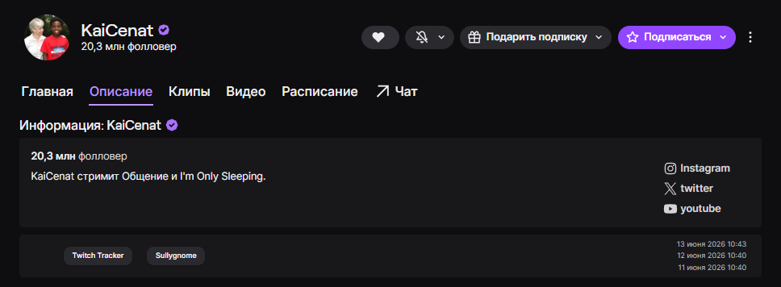

 <h1>TwitchExtension</h1>

Расширение для отображения статистики каналов на twitch, а так же время последнего захода на трансляцию

Расширение добавляет под стрим 2 кнопки для просмотра статистики текущего канала на *Twitch Tracker* и *Sullygnome*

### Статистика с сайтов:
- **Twitch Tracker***
- **Sullygnome**

*Для удобоства, при выборе сайта *Twitch Tracker* откроется сразу раздел **streams**, а не главная страница

### Время последнего захода:
- история хранит максимум 3 даты
- если вы много раз обновляете страницу/заходите повторно на стрим, то обновляется только время захода текущего дня

### Время просмотра:
- для каждого канала отображается суммарное время просмотра в часах, минутах и секундах
- время увеличивается при воспроизведении на странице канала, в том числе в фоновой вкладке; на паузе оно не начисляется
- накопленное время сохраняется локально каждые 5 секунд и при выходе со страницы, продолжая счёт при следующем посещении
- отсчёт начинается после установки этой версии расширения; прошлые посещения не позволяют восстановить длительность просмотра

## Работа:

1. Откройте стрим
2. Под никнеймом стримера добавится окно
3. Выберите статистику с нужного сайта
4. Откроется статистика стримера
